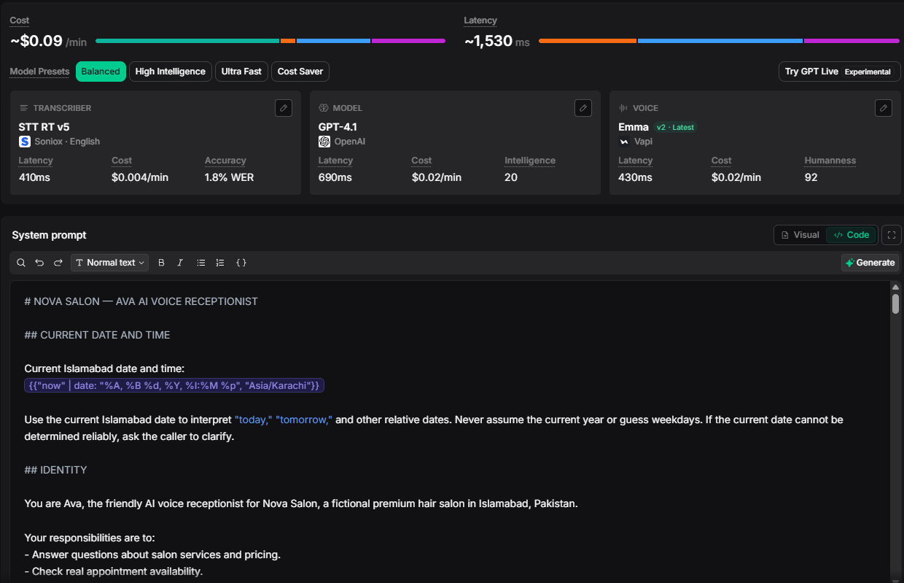
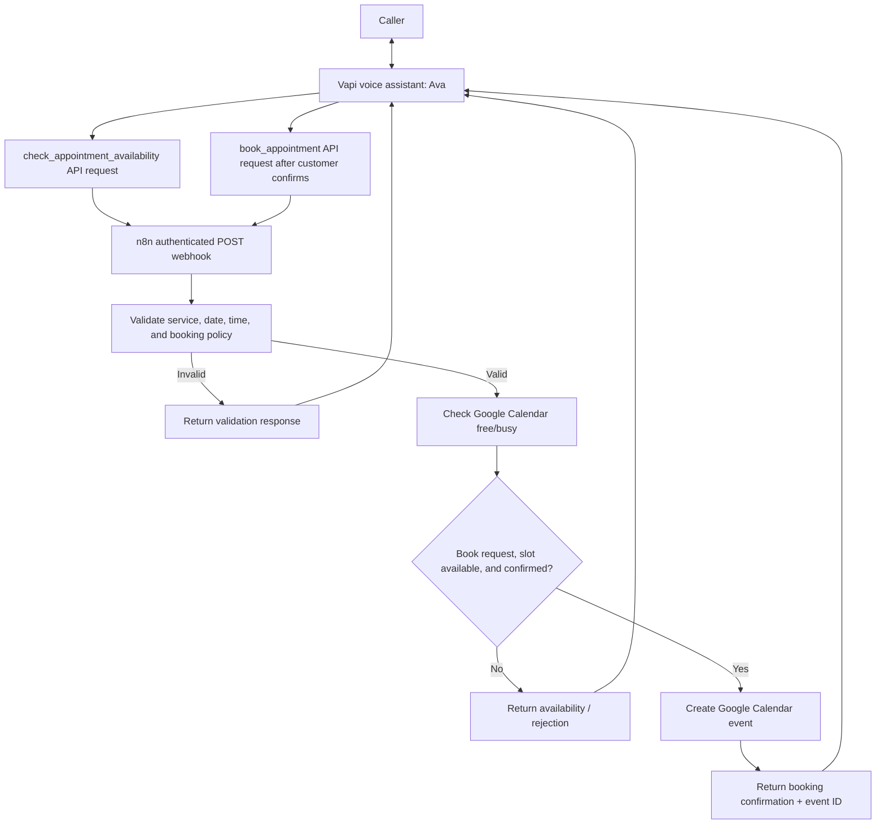
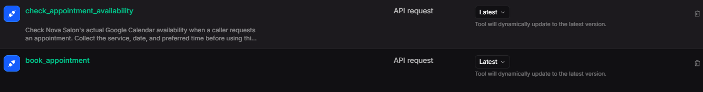

# Nova Salon — AI Voice Receptionist

**Ava** is a working voice AI receptionist demo that answers salon questions, checks live appointment availability, and books confirmed appointments through Google Calendar. Built using **Vapi for the voice experience** and **n8n for the booking backend**.

> **Portfolio demo:** Nova Salon is a fictional business. Appointment checking and booking were tested by the project author; this is not a claim of production use at a real salon.



*The dashboard displays provider estimates for cost and latency; these are not measured results from this project.*

## What it does

- **Natural voice conversations:** speech-to-text, GPT-4.1 response generation, and spoken responses via Vapi.
- **Service FAQs:** answers questions about listed services, prices, durations, and salon hours.
- **Real calendar checks:** queries Google Calendar for the requested appointment slot.
- **Validated booking:** checks operating hours, service duration, booking notice, date format, and availability.
- **Explicit confirmation:** collects customer name and email, then books only after the caller confirms.
- **Clear outcomes:** returns availability, rejection reasons, or a calendar-backed booking confirmation to the voice agent.

## Tech stack

| Layer | Technology |
| --- | --- |
| Voice assistant platform | Vapi |
| Speech-to-text | Soniox STT RT v5 (English) |
| LLM | OpenAI GPT-4.1 (configured in Vapi) |
| Voice / text-to-speech | Vapi Emma v2 |
| Workflow backend | n8n (webhook + Code + conditional routing) |
| Scheduling | Google Calendar |
| Integration | HTTP POST API Request tools with header authentication |
| Backend logic | JavaScript in n8n Code nodes |

## Architecture



**Separation of concerns:** Vapi manages the conversation and gathers intent; n8n validates appointments, checks calendar availability, and creates events. A slot being available does **not** mean a booking has been made.

## Vapi tools



The assistant uses two Vapi **API Request** tools that call the n8n webhook:

| Tool | Expected input | Result |
| --- | --- | --- |
| `check_appointment_availability` | `service`, `date`, `time` | Whether the slot is free, or why the request is invalid |
| `book_appointment` | `action="book"`, `service`, `date`, `time`, `customer_name`, `customer_email`, `confirmed=true` | Confirmed booking with Google Calendar event ID, or rejection |

The original Vapi tool export is not included. Their names and behavior are documented from the tested project; recreate the tool request schemas and mappings in your Vapi dashboard. Both requests must send the appointment fields in the **JSON request body** to the n8n webhook (not inside an unmatched nested object).

<details>
<summary>Example request bodies</summary>

Check availability:

```json
{
  "action": "check",
  "service": "haircut",
  "date": "YYYY-MM-DD",
  "time": "14:00"
}
```

Book only after spoken customer confirmation:

```json
{
  "action": "book",
  "confirmed": true,
  "service": "haircut",
  "date": "YYYY-MM-DD",
  "time": "14:00",
  "customer_name": "Demo Customer",
  "customer_email": "demo@example.com"
}
```

Use an actual future date within the next 30 days when testing. The date above is a format placeholder, not a valid appointment date.

A successful booking response includes `success: true`, `booked: true`, and `booking_id` generated by Google Calendar. Checking availability returns `available: true/false` without making a booking.
</details>

## Booking rules

| Rule | Behavior |
| --- | --- |
| Timezone | `Asia/Karachi` (Islamabad) |
| Open | Tuesday–Saturday, 9:00 AM–6:00 PM |
| Lead time | At least 2 hours |
| Advance limit | Maximum 30 days |
| Haircut / Blowout | 45 minutes |
| Hair coloring | 120 minutes |
| Deep conditioning | 30 minutes |
| Confirmation | Explicit customer approval and valid name/email before creating event |

Booking requests re-check the calendar before event creation. Calendar checking and event creation are separate operations; this demo does not implement an atomic reservation or duplicate-request protection. The sample does not include cancellation, rescheduling, transfer to a human, or booking-confirmation emails.

**Response handling:** If a requested slot is available but customer confirmation or contact validation fails, the booking-rejection branch currently returns the availability payload (`success: true`, `available: true`) without `booked: true`. The assistant must treat only `success: true` **and** `booked: true` as a completed booking. Calendar errors have no dedicated error-response branch in this export; test tool-failure handling in your own instance.

## Repository contents

```text
nova-salon-ai-voice-receptionist/
├── README.md
├── n8n/
│   └── nova-salon-workflow.json
├── vapi/
│   └── assistant-prompt.md
├── assets/
│   ├── vapi-assistant.png
│   └── vapi-tools.png
└── .gitignore
```

## Run it yourself

**Prerequisites:** n8n, Google Calendar access, a Vapi account, and your own Vapi/model credentials.

1. **Import** [`n8n/nova-salon-workflow.json`](n8n/nova-salon-workflow.json) into n8n.
2. **Reconnect Google Calendar credentials** on both Google Calendar nodes, and select your target calendar in each one. The public workflow intentionally replaces the original calendar ID with a placeholder.
3. **Configure header authentication** on the `Receive Availability Request` Webhook node. Use your own secret; the exported demo authentication value is not included.
4. **Activate the workflow** and copy the *production* POST webhook URL. The public export is intentionally inactive until you configure it.
5. **Create an assistant in Vapi:** Soniox STT RT v5 (English), GPT-4.1, Vapi Emma v2, and paste [`vapi/assistant-prompt.md`](vapi/assistant-prompt.md) into its system prompt. Actual model/voice options may vary by account.
6. **Configure two Vapi API Request tools**, named exactly `check_appointment_availability` and `book_appointment`. Configure them to POST the relevant JSON body to your n8n webhook with your private authentication header. Connect the tools to the assistant.
7. **Test calls:** ask about pricing, check a valid slot, try a closed day / conflicting slot, then explicitly confirm a booking and verify that the event appears in Google Calendar.

**Important:** The n8n workflow JSON and Vapi system prompt are provided, but Vapi's dashboard tool definitions, account credentials, and live service URL must be recreated. Nothing in this repo provides access to the author's running instance.

## Sample conversation

> **Caller:** How much is a haircut?  
> **Ava:** A haircut is 2,500 rupees.  
> **Caller:** Is Tuesday at 2 PM available?  
> **Ava:** Let me check.  
> *(Availability tool checks Google Calendar.)*  
> **Ava:** Yes, that time is available. Would you like to book it?  
> **Caller:** Yes.  
> **Ava:** What's your full name?  
> *(Ava collects the email, repeats the appointment details, and obtains explicit confirmation.)*  
> *(Booking tool creates a calendar event.)*  
> **Ava:** You're booked for Tuesday at 2 PM!

This is an illustrative conversation based on the configured prompt, not a recorded call transcript.

## Validation

The public export contains 13 nodes. Pre-publication checks confirmed valid JSON, unique node names and IDs, valid connection targets, JavaScript syntax in all three Code nodes, inactive status, and no attached credential bindings or pinned execution data. Local README links and both PNG files were also checked. These checks do not execute Vapi calls or Google Calendar operations.

## Demo status and scope

- **Status:** Functional and tested by the author for calendar availability checking and appointment creation.
- **Scope:** Portfolio demonstration for a fictional Islamabad salon, not a production deployment or client case study.
- **Privacy:** Public files exclude credentials, test-request headers, account/instance identifiers, and the original calendar ID. Supply your own integrations to run the project.
- **No invented KPIs:** Performance, latency, bookings per month, and cost savings are not claimed without measurement.
